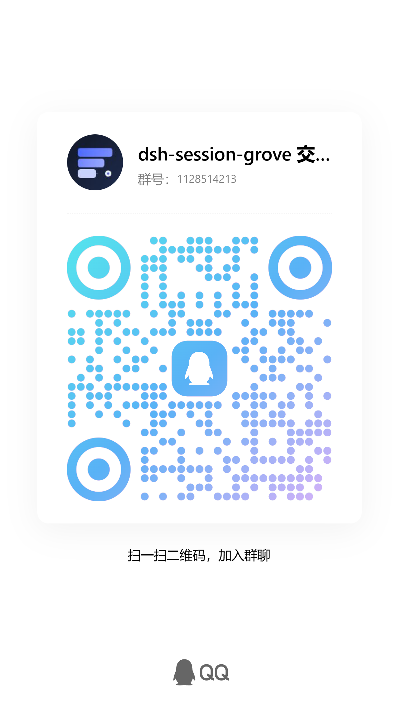

# dsh-session-grove

[English](README.md) | [中文](README.zh.md)

在 DSH Desktop 官方工作区/会话侧栏之上增加一层独立的自由分组。官方工作区/会话管理仍是底层来源：会话仍属于原工作区，日志也不因分组而改变；插件只保存自己的分组归属，因此同一分组可以包含来自不同工作区的会话。

- 把会话归入分组只更新插件自己的分组记录，以及它在自由分组视图中的位置；
- 不改变会话所属的官方工作区、官方工作区注册表和会话日志；
- 会话标题、归档状态只在用户主动操作或开启 `controlSessions` 时由受控接口改变；
- 不写入 `workspace.json`。

当前版本：**0.4.0-beta.59**  
主要支持：**DSH core/API `@deepseek-ai/dsh` 0.2.1-rc.2 与 0.2.1-rc.5**（`engines.dsh: >=0.2.0-rc.2 <0.3.0`）  
已验证桌面壳：**社区版 DSH Desktop Stable 2.0.18**（rc.2）与**官方 DeepSeek Harness 桌面版 0.2.1.0**（rc.5，隔离运行时 A+）  
不官方支持、不承诺兼容：**社区版 DSH Desktop Beta**、**社区版 DSH NEXT（`-next` 通道）**

分发与未发布改动：`0.4.0-beta.59` 已于 2026-11-09 发布（GitHub Release 附件：`.tgz` + `SHA256SUMS`），并已上架 **dshmarket**；GitHub Release 附件与本地 tarball 仅维护者/调试路径。`dev` 在 `.59` 之后还有未发布的多配置（profiles）与切换预览布局修复；下一个 beta 在发布时确定。

本地化：已打包**英文、中文、日文、韩文、德文、法文、西班牙文、巴西葡萄牙文、意大利文、荷兰文、波兰文、土耳其文、越南文、泰文、印度尼西亚文、俄文、印地文、繁体中文、阿拉伯文**字典；locale id 按基础语言解析（`ja-JP` → `ja`、`zh-Hant`/`zh-TW` → `zh-Hant`、`pt-BR` → `pt`），未支持语言回退英文。阿拉伯文会把插件根节点切到 RTL，并带核心列表/header/弹窗的 RTL 覆盖。会话数量与展开标签使用 CLDR 复数模板；分组配置切换器、切换预览与管理弹窗在 19 份字典中均已本地化。插件会把所有字典注册到 Host，但不会主动向 Host 语言目录添加语言。

依赖声明：官方 `@deepseek-ai/*` 运行时包使用 `peerDependencies`，由 DSH 宿主提供，插件不再打包一份重复副本。

兼容性说明见 [docs/COMPATIBILITY.md](docs/COMPATIBILITY.md)：支持范围、`engines.dsh`、`dsh-0.2` 适配器选择器和运行时能力检测。

### 平台支持

插件运行时是平台无关的 JavaScript，不调用 PowerShell，`src/` 中没有 `process.platform` 或 `child_process` 分支。`scripts/qa/` 下的 PowerShell 仅用于维护者测试，不随 npm 包发布。

当前验证状态：

| 平台 | Node/单元测试 | 构建/打包 | 真实 DSH UI |
|---|---|---|---|
| Windows | 本地已验证 | 本地已验证 | 本地已验证 |
| Linux | CI 已验证 | CI 已验证 | 未验证 |
| macOS | CI 已验证 | CI 已验证 | 未验证 |

当前 CI 在 Ubuntu、Windows、macOS 上运行 Node 层门禁（coverage gate 仅 Ubuntu），不等于跨平台 DSH UI 认证：真实 DSH UI 只在 Windows 上验证过，Linux/macOS 的真实 DSH UI 支持在完成真实宿主/UI 验证前属于 experimental。普通用户通过 dshmarket 安装；本地 tarball 和 CLI 仅用于维护者/调试。

兼容性首先由内置的 DSH core/API 决定，而不是桌面壳的名字。官方版和社区版各自内置不同 DSH 版本与插件组合，两个受支持的桌面族必须分别对本插件做回归。

支持的桌面范围：

| 桌面端 | 状态 |
|---|---|
| 社区版 DSH Desktop **Stable** 2.0.18 | 已验证（rc.2） |
| 官方 DeepSeek Harness 桌面版 0.2.1.0 | 已验证（rc.5，隔离 A+ + 维护者桌面窗口验收） |
| 社区版 DSH Desktop **Beta** | 不官方支持；不承诺兼容 |
| 社区版 DSH **NEXT**（`-next` 通道） | 不官方支持；不承诺兼容 |

官方验证覆盖官方 bundle 的 DSH host/core 隔离 web profile，以及已安装桌面 profile 的维护者验收；不代表官方 profile 内所有第三方插件组合都已认证。

Beta 和 NEXT 即使能加载插件，也不构成发布门禁，不扩大支持承诺。

## 功能

### 视图

- 自由分组视图与官方工作区视图切换
- 左侧栏宽度可拖动调整（264px 起，默认 420，最大为窗口宽度 80%）
- 双击宽度把手恢复默认宽度
- 视图模式、宽度、折叠状态、归档筛选、弹窗位置都会持久化

### 分组配置

分组配置属于 `dev` 上未发布的改动，`0.4.0-beta.59` 发布包不包含该功能。

分组配置（profile）是一份命名的分组方案：拥有自己的分组树与会话归属，但共用同一份官方工作区/会话数据。切换只改变显示哪份分组文档，不复制、不改写、不删除会话。

- 通过标题后的 chevron 切换配置
- 切换前先显示只读差异预览（分组新增/移除/改名/移动/重排，会话移动/新归组/回未分组/失效）；内容相同的配置直接切换，不弹预览
- 把当前配置另存为新配置；重命名配置；归档不再需要的配置
- 最多 20 个未归档配置（含 default）
- active 配置是全局的：所有窗口跟随同一个 active，通过 SSE 自动更新；切换不会改写其他配置的文档
- 归档只从切换列表隐藏，配置文档、备份与会话都保留
- 切换成功的 toast 提供 5 秒“撤销”，可切回上一个配置

### 分组

- 新建根分组与子分组（最多 8 层）
- 重命名、更换图标、预设色板与自定义 `#RRGGBB`
- 分组拖拽排序、改父级、子树跟随
- 组菜单提供上移/下移兜底
- 折叠/展开
- 空叶分组直接删除
- 非空分组删除前选择直接会话与直接子组的目的地
- 分组内新建会话（使用推断工作区；首次发消息前切换工作区仍跟回该组，工作区切换/新建仍交给宿主 UI）

### 会话

- 把不同工作区的会话归入同一个分组
- 把会话拖出分组，回到未归组
- 打开、重命名、归档/取消归档、归入分组
- 行 hover 提供归档/取消归档
- 会话菜单提供分叉会话、复制 Session ID
- 分叉会以最后一个已完成轮次为分叉点；成功后将子会话放到源会话所在分组顶部（源会话未归组时放到未分组顶部）
- 官方会话状态显示
- 未归组列表虚拟化

### 搜索与筛选

- 搜索会话标题、工作区、分组路径
- 选中后展开祖先、滚动并高亮
- 归档结果置灰不可打开
- 归档三态：隐藏 / 显示全部 / 仅归档

### 头部状态

只有三个统计按钮：

- **执行中**（spinner）
- **等待用户介入**（pause）
- **未读**（mail）

每个按钮的下拉按分组列出会话，点击打开。  
“执行中 / 待介入 / 未读”是互斥的主状态统计，不包含后台 job 统计。

### 弹窗

- 标题栏拖动、八方向缩放
- 点击背景不关闭，Cancel/Esc 关闭
- 紧凑尺寸和主题 token
- 5px 自绘可拖动细滚动条；无渐隐箭头

### 首次使用

首次进入自由分组视图会显示一次性说明卡：

- 分组只改变会话在自由分组视图中的编排，不改变官方工作区归属和日志
- 如何新建分组、拖拽会话与组头

说明卡可 dismiss，状态写入 `localStorage`。  
没有分组且没有会话时会显示“新建第一个分组”的空状态入口。

### 视图选项

右上角“视图选项”包含：

- 归档三态
- **恢复默认布局**：恢复侧栏宽度、全部展开、清除弹窗位置尺寸；不动分组数据
- 版本与作用范围说明

## 安装

### dshmarket（推荐）

在 **dshmarket** 中搜索并安装：

```text
dsh-session-grove
```

市场条目已上架（经 `awesome-dsh-plugin` 目录）。普通用户应完全通过 dshmarket 安装和更新，不需要本地路径或命令行。

更新由 dshmarket / 插件管理器负责。插件不做自更新，也不知道下一版本的下载地址。如果之前用本地 tarball 安装，需要通过市场重新安装一次，让安装来源绑定到目录。

### 从 `dsh-session-groups` 升级

`0.4.0-beta.1` 的身份重置意味着本包**不会自动读取、复制或删除**旧 `dsh-session-groups` 的分组文件和浏览器键；这是为了避免把同名社区插件的数据误导入。手动迁移步骤见 [docs/MIGRATION-0.4.md](docs/MIGRATION-0.4.md)。

从更早的 `dsh-session-grove` 版本升级不需要迁移：现有记录自动成为 `default` 配置；命名配置在第一次“另存为新配置”之前并不存在。

### 维护者/开发者安装

本地 tarball 和命令行安装只用于开发调试，步骤见 [docs/RELEASE.md](docs/RELEASE.md)；普通用户不需要使用。

## 数据

默认配置（default）的分组文档仍在：

```text
<dshHome>/storages/dsh-session-grove.json
```

配置元数据与其他配置文档：

```text
<dshHome>/storages/dsh-session-grove.profiles.json                    # registry：activeId、名称、归档标记、revision
<dshHome>/storages/dsh-session-grove.profiles.json.bak                # registry 备份
<dshHome>/storages/dsh-session-grove.profiles.json.lock               # 跨进程 registry 锁
<dshHome>/storages/profiles/<id>/dsh-session-grove.json               # 每个命名配置一个目录
<dshHome>/storages/profiles/<id>/dsh-session-grove.json.bak
<dshHome>/storages/profiles/<id>/dsh-session-grove.corrupt-<ts>.json  # 该文档损坏时的隔离副本
```

- 写入使用 revision 比较与串行队列
- 冲突时加载最新版本
- `default` 配置的 `/load` 沿用旧的 `load()` 恢复语义：损坏或非法记录会先隔离，`.bak` 有效时自动恢复，否则返回健康空文档并带 warning（200）；文件缺失也视为健康空文档
- active 为命名配置时，`/load` 只做只读探测（`peek`）：文档损坏、非法或缺失会返回 `409 profile-unhealthy` / `profile-missing`，不隔离、不恢复 `.bak`、不写空文档；界面显示恢复条（recovery strip），可切换到健康配置，原文件保留在磁盘上。命名配置不会静默降级为空分组；命名配置的 `.bak` 恢复/隔离只发生在写路径与控制/原生工具读取所用的 `load()` 路径
- 成功提交前保留单槽 `.bak` 备份
- registry 保存 `activeId` 与一个 revision，所有窗口对 active 配置保持一致
- 每个配置有独立的 `.bak`、`.lock` 和隔离文件族；一个配置损坏不会覆盖或误计到另一个配置
- 归档配置只写 `archivedAt` 标记：文档、备份与会话都留在磁盘上，不删除任何文件
- 已有的单配置安装就是 `default` 配置；升级不会迁移、重命名或复制 `dsh-session-grove.json`；registry 在第一次写配置时创建（save-as/create 或 rename/archive/activate），而 `profiles/` 只在首次保存命名配置（save-as/create）时创建
- 不支持配置的旧版本只读 default 文档、忽略 registry；重新升级后配置仍在
- 不写官方工作区与会话数据

本地 UI 偏好与可选诊断/性能开关（localStorage）：

- `dsh-session-grove.view.v1`
- `dsh-session-grove.archive.v1`
- `dsh-session-grove.collapsed.v1`（值已改为 `{[profileId]: {[groupId]: true}}`；旧的扁平值按 default 配置读取，并在下一次写入时升级）
- `dsh-session-grove.width.v1`
- `dsh-session-grove.onboarded.v1`
- `dsh-session-grove.profilePreview.v1`（`'0'` = 以后跳过切换预览、直接切换）
- `dsh-session-grove.dialog.geometry.v9`
- `dsh-session-grove.diagnostics`（页面加载时的诊断 trace 开关；`'1'`/`'true'` 开启）
- `dsh-session-grove.perf`（可选的性能探针开关；`'1'` 开启）

卸载插件后官方工作区视图恢复；分组文档、registry、备份和本地偏好保留，重装可恢复。需要彻底清理时删除 default 记录、registry 及其 sidecar、整个 `profiles/` 目录、控制 token、诊断/调试 NDJSON 文件（如有）与对应 localStorage 键。

## 配置

插件管理器提供五个开关，默认都关闭。设置卡位于 **Plugins → dsh-session-grove 插件详情第一层**，无需进入组件行。所有开关使用标准 DSH `Switch`，信息按钮使用标准 `Tooltip`。

| 配置 | 默认 | 作用 |
|---|---|---|
| `diagnostics` | 关闭 | 拖拽 HUD 与本地 NDJSON trace；切换后热生效 |
| `debugProbe` | 关闭 | 临时弹窗布局探针与 `.debug.ndjson` 路由；生产使用不要开启 |
| `controlApi` | 关闭 | AI 控制总开关：原生 `session_grove_control` 工具 + 浏览器/调试 HTTP 路由 |
| `controlDestructive` | 关闭 | 允许 AI 控制接口执行删除等破坏性操作；开启前需二次确认 |
| `controlSessions` | 关闭 | 允许会话改名、归档状态切换；需同时开启 `controlApi` |

`debugProbe` 路由始终注册，但关闭时返回 `404 debug-disabled`，且不会写调试文件。  
`diagnostics` 路由始终注册，但关闭时拒绝写入；开启/关闭会在下一次配置刷新时更新客户端 HUD。  
`controlApi` 关闭时 control 路由仍注册，但返回 `404 control-disabled`；开启后仅本地可用，并复用 host connection fence。  
后台任务监控已在 0.3.0-beta.1 回滚，不订阅 `ctx.jobs`、不额外开启 job 流。

## 设置卡

- 配置卡在第一层插件详情页，不再依赖第二层组件行入口。
- 五个选项均有 `[ⓘ]` 详情入口，内容包括功能、何时开启、安全风险、其他影响。
- `controlDestructive` 不是普通开关：开启时先显示危险确认，必须显式点击“我理解风险，开启”。
- 第二层组件行保留来源/状态等元数据，但不作为配置入口。

## AI 控制

AI 的主通道是 Host 原生工具：

```text
session_grove_control
```

它直接在 DSH Host 进程内执行，不经过 HTTP、不需要浏览器 Cookie、不需要
control token，也不依赖 CLI。`controlApi` 必须是开启状态；`controlSessions`
控制会话改名/归档；`controlDestructive` 控制删除。

Host 在每次分组 commit（原生工具或 HTTP）后通过 `/dsh-session-grove/events` 广播新 revision；浏览器收到后重新 load 对账。切回自由分组视图时也会主动重新 load。

`doctor` 是只读兼容性诊断，可在 `controlApi` 关闭时调用；
它返回宿主能力、适配器/版本范围、控制门禁、存储路径、存储健康（status/revision、backupStatus/backupRevision/backupError、quarantine）、服务存在性与已挂载路由。

工具动作：

```text
catalog
state
resolve
plan
apply
session_inspect
session_rename
session_archive
doctor
```

`catalog` 是只读词表与格式参考：图标 id/分类/style、色板 id/hex/label、`colorHex`
输入形式与 canonical `#rrggbb`、操作名和限制。它不读取分组状态或 revision。

`state` 返回稳定 `revision`、每个分组的 `id`/`path`/icon/color 和 sessionIds。
`resolve` 只把完整 path 数组解析成 ID；不存在返回 `group-not-found`，同名同级
返回 `ambiguous-path` 并给出 candidates。`plan` 返回 `changes` 和 `planHash`；
`apply` 必须带同一个 `planHash` 和 `baseRevision`，用 CAS 提交。

外观字段严格校验：`icon`/`color` 必须来自 `catalog`，`colorHex` 接受
`#RGB`、`RGB`、`#RRGGBB` 或 `RRGGBB` 并持久化为小写 `#rrggbb`，`color` 与
`colorHex` 互斥。非法值返回 `invalid-icon`/`invalid-color`，不再静默回退。

会话动作必须显式传 `sessionId`；缺失就是 `invalid-session-id`，不猜最近会话。
改名用 `expectedTitle`，归档用 `expectedArchived`；运行中的会话归档需要显式
`stopActivity: true`。

### 分组配置与 AI 控制

原生工具与 HTTP 控制路由都接受可选的 `profileId`：

- `state` 与 `resolve` 缺省使用 active 配置，响应回显 `profileId` 与 `activeProfile`；
- 存在多于一个未归档配置时，`plan` 与 `apply` 必须传 `profileId`（422 `profile-required`）；只有 `default` 时仍可省略，旧提示词保持可用；
- `planHash` 包含 `profileId`，为一个配置生成的 plan 不能应用到另一个配置；
- 不提供 `activate`/`switch` 动作：AI 可读写指定配置的分组，但不能改变用户当前查看的配置；
- 原生工具没有 apply 重放缓存；HTTP `/control/apply` 的 `idempotencyKey` 缓存键为 `${profileId}:${idempotencyKey}`，同一个 key 可在不同配置复用；
- `doctor` 的只读报告新增 `storage.registry` 与 `storage.profiles[]`（`id`/`name`/`archived`/`healthy`/`revision`/`backupStatus`）；
- CLI 的 `--profile` 只适用于 `state`/`resolve`/`plan`/`apply`：`state` 与 `resolve` 可省略（用 active），`plan`/`apply` 在多配置时必须提供；`doctor` 与会话动作是 host-scoped 的，传 `--profile` 会以 usage 错误拒绝。

### 可直接复制的 AI 提示词

先开启 **AI 控制接口**；改名提示还需要开启 **会话操作**。不需要命令行、HTTP、Cookie 或 token——把下面的话发给会话里的 AI，让它调用 `session_grove_control`。

#### 批量创建项目分组架构

> 用 `session_grove_control` 创建或复用以下分组层级：
>
> `〈项目名〉项目组` — 图标 `server`，颜色 `blue`
> - `设计中` — 图标 `book`，颜色 `purple`
> - `开发中` — 图标 `play-circle`，颜色 `blue`
> - `已挂起` — 图标 `clock`，颜色 `orange`
> - `已完成` — 图标 `check-circle`，颜色 `green`
> - `已取消` — 图标 `x-circle`，颜色 `red`
>
> 已有分组复用，只补缺失的子组。先查 `state`/`resolve`；路径不存在或有歧义就停下来问我。再 `plan`，把 `changes` 和 `planHash` 给我看，最后用同一个 `planHash` 和 `baseRevision` 执行 `apply`。

#### 改名并归入分组，一条指令完成

> 把当前会话改名为「〈新名称〉」，然后归入「〈项目名〉项目组 / 开发中」。使用 `session_grove_control`；先拿到当前会话明确的 `sessionId`，不要猜。先改名，再用 `plan`/`apply` 执行 `session.assign`。任一步失败就停止，并告诉我卡在哪一步。这是一条指令里的两个连续操作，不是单个事务。

### HTTP 路由（浏览器/调试）

以下路由保留给浏览器设置页和本地调试，不作为 AI CLI 的主通道：

```text
GET  /dsh-session-grove/control/doctor
GET  /dsh-session-grove/control/catalog
GET  /dsh-session-grove/control/state
POST /dsh-session-grove/control/resolve
POST /dsh-session-grove/control/plan
POST /dsh-session-grove/control/apply
POST /dsh-session-grove/control/session/inspect
POST /dsh-session-grove/control/session/rename
POST /dsh-session-grove/control/session/archive
```

真实 DSH Desktop 的 Host 浏览器会话 fence 在插件路由之前执行。CLI 使用
`DSH_WEB_URL`（含 `?token=`）先交换 DSH web cookie，再带插件 Bearer token；
`doctor` 可在 `controlApi` 关闭时执行，其他控制路由仍受各自门禁保护。示例：

```powershell
$env:DSH_HOME = "$env:USERPROFILE\.dsh"
$env:DSH_WEB_URL = "http://127.0.0.1:43120/?token=启动时打印的token"
node scripts/session-grove-control.mjs doctor
```

原生工具仍是 AI 的主通道；CLI 只用于本地只读诊断和调试。`doctor` 在 host compatibility 不支持时返回非零退出码，可直接用于升级前/后脚本门禁。

`group.create` 的 plan 结果不返回 `groupId`：ID 只在 apply 时生成，apply 后重新
`state` 读取新 ID。

插件在以下位置写入本地控制 token（权限 0600）；`controlApi` 关闭时除 `doctor`
外的控制路由仍返回 404，token 本身不能绕过 Host 浏览器 fence：

```text
<dshHome>/storages/dsh-session-grove.control-token
```

包内置 skill：`skills/session-grove-control/SKILL.md`。开启 `controlApi` 后，插件会自动安装到 `<dshHome>/skills/session-grove-control/SKILL.md`；插件详情页设置卡提供“校验 / 重装技能”按钮，可修复丢失或损坏的 managed skill，无需卸载整个插件。用户自己创建的同名 skill 不会被强制覆盖。

诊断文件位置：

```text
<dshHome>/storages/dsh-session-grove.diagnostics.ndjson
```

仅在 `diagnostics` 开启时写入；内容为拖拽事件/ID/timing，不包含会话 transcript。文件在追加前若将超过 8 MiB 会先清空；不做自动轮转，需要时可手工清理。

## 语言

- 只跟随主框架当前语言，不提供插件自己的语言切换入口。
- 已打包 19 种字典（`en zh ja ko de fr es pt it nl pl tr vi th id ru hi ar zh-Hant`），并全部注册到 Host locale service。
- 语言是否可选由 Host 或第三方语言包决定；插件不调用 `addLanguage`，不添加语言选择器，也不主动向 Host 语言目录加入语言。
- locale id 按基础语言解析（`ja-JP` → `ja`）；`zh-Hant`/`zh-TW`/`zh-HK` 命中繁体中文资源；`zh-CN`/`zh-Hans` 命中简体中文；未知语言回退英文。
- 用户创建的分组名、会话名和工作区名不翻译。

## 已知限制

- 状态统计只覆盖分组文档中已归组或显式未归组的会话；自动派生的未归组会话不进入头部计数。
- 分组、折叠状态与弹窗位置是单窗口本地状态；多窗口冲突通过 409 提示，不做实时合并。
- active 配置对 DSH 实例全局生效；“每个窗口独立 active”未实现，所有窗口跟随同一个切换。
- 归档配置在“管理配置”中只读展示；恢复 UI 未实现（目前只能改 registry 里的 `archivedAt`）。
- AI 控制可以读写指定配置，但不能切换 active 配置。
- 切换预览的 token 由 active、目标和 registry 三个 revision 派生：其他窗口切换 active 会关闭本窗口已打开的预览；预览期间 active/目标文档或 registry 变化时，点击确认会收到 `409 preview-stale`，预览被标记为过期、确认按钮禁用，必须重新打开预览，宿主仍会拒绝旧 token；极窄窗口下预览弹窗按视口 clamp，长差异列表需要纵向滚动。
- 重命名后“管理配置”列表刷新不走强制归档行读取（归档路径是强制的）；旧响应可能短暂隐藏新归档行，重新打开弹窗即恢复。
- `profiles.counts` 用同一个 CLDR 复数模板显示分组数与会话数；少数语言会出现近似的名词形式（例如英文 “1 sessions”）；后续应拆分为 `countsGroups` / `countsSessions` 两个键，当前仍为 deferred。
- 写入使用进程内队列 + 短生命周期 `<record>.lock` 文件做跨进程串行化；持有者 PID 消失或锁文件超过 30 秒时会自动回收。
- 大列表懒渲染仍在 deferred；当前只虚拟化未归组列表，折叠子树的 React 节点仍会构建。
- 搜索最多返回 20 条，只匹配标题/工作区/组路径。
- 宽度覆盖依赖 DSH 左侧栏 DOM；宿主大改布局时 fail-soft，分组功能不受影响。
- 对话框移动/缩放已有键盘支持；全量 axe/对比度审计和整棵树的键盘拖拽仍为 deferred。
- 已发布的 `0.4.0-beta.59` 以 **529 项单元/契约测试 + 15 个 UI runtime case** 验证；`dev` 上未发布的 profiles + 预览修复当前为 **699 项单元/契约测试 + 39 个 UI runtime case + 1 个浏览器 runtime spec**；用户桌面回归是历史证据，不是每个候选版本的 CI 产物；`e2e/groups.spec.mjs` 是历史手工脚本，不进入默认门禁，当前脚本化 A+ 为 `e2e/isolated.spec.mjs`（需手工对隔离宿主运行，不在 CI 内）。手工 spec 中的配置 UI 流程已于 2026-11-09 在社区版隔离宿主通过（`test:isolated`、`test:ui-browser`、`test:locale-pack`、`test:all-locales` 23/23）；官方宿主的配置证据仍待补。`npm run check:release` 是 release workflow 强制的发布结构门禁（版本一致、tag 匹配、release note、客户端版本戳、打包路径）；A+ 和 all-locales 是手工本地证据，不是 CI 产物。

## 文档

- [当前文档索引](docs/INDEX.md)
- [测试矩阵](docs/TEST-MATRIX.md)
- [本地化状态](docs/I18N.md)
- [兼容策略](docs/COMPATIBILITY.md)
- [架构](docs/ARCHITECTURE.md)
- [发布与验证](docs/RELEASE.md)
- [历史测试结果（0.4.0-beta.13 快照）](docs/TEST-RESULTS.md)

历史 V1/V1.1 契约与计划单独索引，不代表当前行为。

## 开发

```powershell
npm run check:style
npm test
npm run build
npm run check:lib
node --check lib/client.js
npm run check:coverage
npm run check:ui
npm run check:release
npm pack
```

- `npm test`：699 项单元/契约测试
- `npm run check:style`: zero-dependency style guard (tabs/trailing whitespace/final newline)
- `npm run check:lib`: rebuild and verify lib/ is current with src/
- `npm run test:ui-browser`: real-browser UI runtime coverage (isolated host; manual)
- `npm run check:ui`：UI runtime smoke（39 个 UI runtime case：1 个模块加载 + 38 个组件测试，覆盖 17 个组件、21 个客户端模块；不并入逻辑 coverage）
- `npm run check:coverage`：Node 内置 coverage 报告（当前约 93.1% lines / 83.9% branches / 90.5% functions）
- `npm run check:release`：release workflow 发布门禁；校验 `package.json` / `dsh.plugin.json` / `src/shared/constants.js` / `package-lock.json` 版本一致；设置了 `GITHUB_REF_NAME` 时要求 tag 等于 `v<version>`；并检查 release note、`lib/client.js` 版本戳和 `package.json.files` 的全部路径
- 分层：`src/core` 纯函数核心，`src/adapters` 承载 DSH 版本适配；见 `docs/ARCHITECTURE.md`
- `npm run check:all`：全文件语法检查 + 测试
- `npm run check:core`：只加载并测试 src/core，不启动 DSH
- `scripts/qa/clean-profile.ps1`：隔离 profile 安装/卸载验证，不碰真实 `~/.dsh`
- `scripts/qa/lifecycle-isolated.ps1`：隔离 install → uninstall → reinstall，校验分组记录 hash 不变
- `scripts/qa/start-isolated-web.ps1` + `npm run test:isolated`：A+ 隔离 Playwright 冒烟（手工本地证据，release workflow 不运行）
  - 覆盖首次引导、搜索、归档筛选、拖拽自动展开、拖拽边缘、弹窗拖动/缩放、三状态按钮、归入分组 head、收起/展开顺序、264px、英文/深色、宿主侧栏 Rail、亮色对比度
  - 覆盖外部 commit SSE 刷新、同上下文双页面同步、同 baseRevision 并发 CAS（一胜一 409）、EventSource 强制重连、会话菜单 Copy Session ID（真实剪贴板 + toast）、hover archive 存在、第一层设置、本地化标题、详情 tooltip、Switch 交互、live diagnostics HUD、destructive 二次确认取消
  - 配置流程覆盖：新建/另存为、切换与差异预览、相同内容直切、重命名/归档、20 上限、default 恢复、双窗口 active 收敛与 `profile-changed` 409、折叠状态按配置隔离；unhealthy-active 恢复条不在 A+ 覆盖内，仍为手工/待补
  - 必须先启动独立 web，取得 `web.json` 的 URL 和 testHome
  - Playwright 拒绝真实 43120 端口和真实 `~/.dsh`
- 构建产物：`lib/client.js`
- 发布包：`dsh-session-grove-0.4.0-beta.59.tgz`
- 详细发布步骤见 `docs/RELEASE.md`
- 历史测试快照见 `docs/TEST-RESULTS.md`（0.4.0-beta.13；当前状态以 `docs/TEST-MATRIX.md` 为准）

## 交流群

DSH Session Grove 用户交流 QQ 群（暂无微信群）：



## 许可

MIT，见 `LICENSE`。


